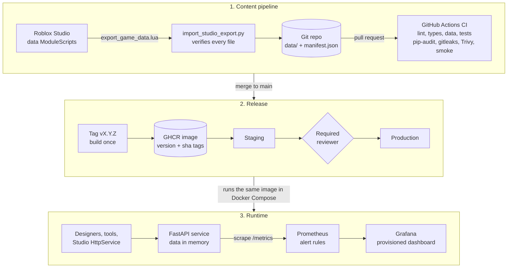
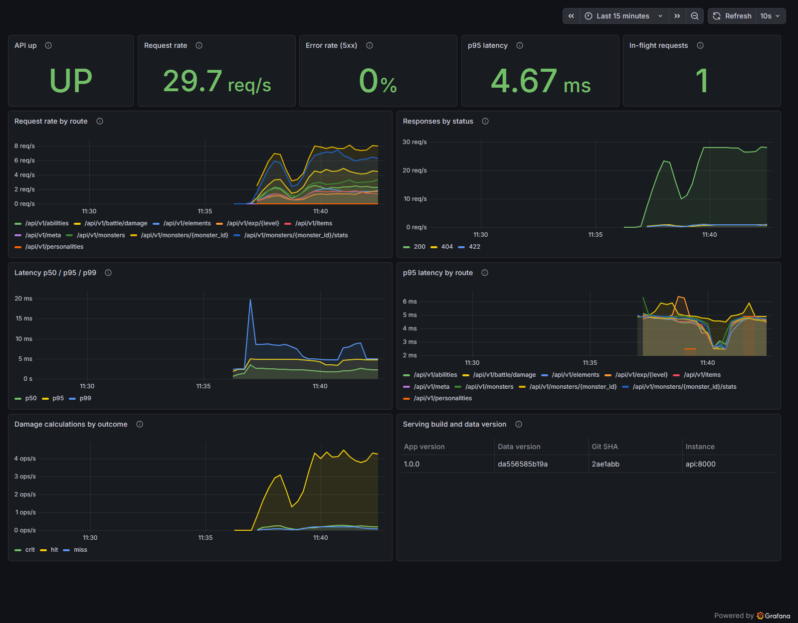

# Duo Game Data API

A read-only companion API for **Lanternfall**, my monster-taming RPG on Roblox,
wrapped in the delivery pipeline a live-service game team would run: validated
content deployments, container builds with security gates, environment
promotion with an approval step, and observability as code.


## Quick Start

Requires Docker Desktop (or Docker Engine with Compose v2).

```bash
git clone https://github.com/FarhanOsMo/duo-game-api.git
cd duo-game-api
docker compose up -d --build
```

Then open the API docs at <http://localhost:8000/docs>, Prometheus at
<http://localhost:9090> and Grafana at <http://localhost:3000> (user `admin`,
password `change-me-locally` unless you set your own in `.env`). The commands
are identical in PowerShell. No Docker? See [Run without Docker](#run-without-docker).

## Project Summary

The Duo Game Data API serves the game's exported balance data (monsters,
abilities, items, elements, personalities, config) and re-implements the
game's stat, experience, element and damage formulas so designers and tools
can ask "what does this monster look like at level 30?" or "how hard does this
attack hit?" without opening a play session. The application is deliberately
small. The work is in everything around it:

- **Content pipeline.** Game data goes from Roblox Studio into Git through a
  one-paste import that verifies the copy, is validated on every pull request,
  and is versioned by a content hash.
- **CI/CD.** GitHub Actions runs lint, strict typing, data validation, tests
  with a coverage gate, dependency audit, secret scanning, workflow linting, an
  image build, a Trivy scan and a smoke test. Releases publish one image to
  GHCR and promote it from staging to an approval-gated production.
- **Containers.** A multi-stage, digest-pinned, non-root image with a
  healthcheck, run read-only with all capabilities dropped.
- **Observability as code.** Prometheus metrics, alert rules with unit tests,
  and a Grafana datasource and dashboard provisioned from the repo.

## Problem Statement

In a live-service game, content changes are deployments. A balance pass that
renames an ability, a typo in an element name, or a monster whose gender rates
no longer add to 100 can break the game as surely as a code bug, yet game data
is often edited by hand, copied between tools and shipped without review.

For my own game the concrete problems were:

1. The balance data lives in Studio ModuleScripts, so checking a number means
   opening Studio. There is no reviewable history of what changed and when.
2. Nothing checked that the data files agree with each other before they ship.
3. The formulas (stats, experience, damage) live in server code, so answering
   a balance question meant running the game.
4. There was no way to tell which data version a tool was looking at.

## Why I Built This

I want to work on a platform, SRE or DevOps team at a game studio or
live-service platform, the people who make it safe for designers and engineers
to ship many times a day. Those teams care about content and data deployments,
balance tooling, the uptime and latency of game backends, and safe rollouts.
This project is a small, honest version of that work built around a real game
I am making.

The real DevOps problem it addresses is **treating game content as code**:
every data change is reviewed, validated by automated gates, versioned,
observable in production and reversible. The tools are the ones those teams
use: GitHub Actions, Docker, Prometheus and Grafana. Studios also run
Terraform, Kubernetes, Datadog and other HashiCorp tools. I did not use those
here because of the zero-cost constraint, but [DEPLOYMENT.md](docs/DEPLOYMENT.md)
maps each part of this pipeline onto them.

What this API is **not**, stated plainly:

- It holds **its own copy** of the data and does **not** auto-sync with
  Studio; updates go through the [data sync workflow](docs/DATA_SYNC.md).
- **Live Roblox servers cannot reach it** on `localhost`; only a Studio
  session with HttpService enabled can call it
  ([example](docs/roblox-client-example.lua)).
- It is **read-only** and can never change the game, player saves or live servers.
- **Formulas are code, not data.** A change to a formula in the game needs a
  matching change here; the golden-value tests exist to catch that drift.

## Technologies Used

| Area | Tools |
|---|---|
| Application | Python 3.12, FastAPI, Pydantic v2, Uvicorn |
| Quality | pytest, pytest-cov, ruff, mypy (strict), pre-commit |
| Security | gitleaks, pip-audit, Trivy, Dependabot, SHA-pinned actions |
| Containers | Docker (multi-stage build), Docker Compose with environment overrides |
| Observability | Prometheus (metrics, alert rules, promtool tests), Grafana OSS (provisioned) |
| CI/CD | GitHub Actions, GitHub Container Registry, GitHub environments |
| Load testing | Locust |
| Game side | Roblox Studio, Luau (export script and client example) |

## Architecture Overview



**Request path.** At startup the service loads all eleven data files into
immutable Pydantic models, cross-checks every reference, and refuses to start
if anything is wrong. Each request is handled from memory by thin routers in
`app/api` that call pure formula functions in `app/domain`. Middleware gives
every request an id (echoed in the `X-Request-ID` header, the JSON log line
and any error body) and records Prometheus metrics labelled by route template.

**Layers.** `app/api` holds the HTTP routers and error handling. `app/domain`
holds the pure formulas (`stats.py`, `elements.py`, `damage.py`) with no I/O.
`app/data` holds the loader, models, validator and manifest. `app/core` holds
environment config, JSON logging and metrics.

### Endpoints

| Method | Path | Purpose |
|---|---|---|
| GET | `/health` | Liveness: the process is up |
| GET | `/ready` | Readiness: data loaded, returns the data version |
| GET | `/metrics` | Prometheus metrics |
| GET | `/api/v1/meta` | App version, git SHA, environment, data version and files, uptime |
| GET | `/api/v1/monsters` | List monsters; filters `element`, `family`, `rarity` |
| GET | `/api/v1/monsters/{id}` | One monster |
| GET | `/api/v1/monsters/{id}/stats` | Stat block for `level`, optional `personality` and `potential_<stat>` |
| GET | `/api/v1/abilities`, `/api/v1/abilities/{id}` | Abilities |
| GET | `/api/v1/items`, `/api/v1/items/{id}` | Items; filter `category` |
| GET | `/api/v1/elements` | Elements, multipliers and the full attacker-by-defender matrix |
| GET | `/api/v1/elements/effectiveness` | Multiplier for `attack` vs `defend` |
| GET | `/api/v1/personalities` | Personalities and stat modifiers |
| GET | `/api/v1/config` | Game and battle configuration as exported |
| GET | `/api/v1/exp/{level}` | Total EXP needed for a level |
| GET | `/api/v1/exp/level-for` | Level reached with `exp` points |
| POST | `/api/v1/battle/damage` | One hit's damage; deterministic with `seed` or fixed values |

Every error uses one shape: `{"error": {"code", "message", "request_id"}}`.
Example damage request (the golden value from the game, damage 6):

```bash
curl -X POST http://localhost:8000/api/v1/battle/damage \
  -H "Content-Type: application/json" \
  -d '{
        "ability": "ab_cinder_spit",
        "attacker": {"species": "mon_placeholder_a", "level": 5},
        "defender": {"species": "mon_placeholder_b", "level": 5},
        "fixed_variance": 1.0, "force_hit": true, "force_crit": false
      }'
```

PowerShell:

```powershell
$body = @'
{
  "ability": "ab_cinder_spit",
  "attacker": {"species": "mon_placeholder_a", "level": 5},
  "defender": {"species": "mon_placeholder_b", "level": 5},
  "fixed_variance": 1.0, "force_hit": true, "force_crit": false
}
'@
Invoke-RestMethod -Method Post -Uri http://localhost:8000/api/v1/battle/damage `
  -ContentType "application/json" -Body $body
```

### Data sync in one paragraph

Run `tools/export_game_data.lua` in Studio's Command Bar, copy the whole
Output window, and run `python scripts/import_studio_export.py`. The script
reads the clipboard, rebuilds all eleven files, checks each against the
exporter's own character counts, and writes nothing if anything is missing.
Commit on a branch and open a pull request; CI validates the data, runs the
golden-value tests and checks the manifest. After release, `/api/v1/meta`
shows the new data version. Full details: [docs/DATA_SYNC.md](docs/DATA_SYNC.md).

### Project structure

```text
duo-game-api/
├── app/
│   ├── api/            HTTP routers, dependencies, error handling
│   ├── core/           settings from env, JSON logging, Prometheus metrics
│   ├── data/           loader, Pydantic models, validator, manifest, rule adapters
│   └── domain/         pure formulas: stats.py, elements.py, damage.py
├── data/               11 JSON files exported from Studio + manifest.json
├── deploy/
│   ├── prometheus/     scrape config, alert rules, promtool rule tests
│   └── grafana/        provisioned datasource, dashboard provider, dashboard JSON
├── docs/               ADRs, data sync, deployment, reflection, build log, images
├── env/                dev.env, staging.env, prod.env
├── loadtest/           Locust scenario
├── scripts/            validate, manifest, Studio import, smoke test, traffic,
│                       word count, PDF, bootstrap (bash + PowerShell)
├── tests/              unit (golden values, properties), data, API tests + fixtures
├── tools/              export_game_data.lua (runs in Roblox Studio)
├── .github/            CI and release workflows, Dependabot, PR template, CODEOWNERS
├── Dockerfile, docker-compose.yml, compose.staging.yml, compose.prod.yml
└── Makefile, pyproject.toml, requirements*.txt, .env.example, .pre-commit-config.yaml
```

## Key Design Decisions

Each decision has a short ADR in [docs/adr](docs/adr/README.md).

| Decision | Why |
|---|---|
| [FastAPI](docs/adr/0001-fastapi.md) | Type-driven validation, consistent 422s and free OpenAPI docs; the same Pydantic models validate the game data. |
| [Stateless, no database](docs/adr/0002-stateless-no-database.md) | 25 KB of read-only data needs no server, migrations or backups; replicas are interchangeable and rollback is redeploying an image. |
| [Pure domain functions, seeded RNG](docs/adr/0003-pure-domain-seeded-rng.md) | Formulas are tested against the game's golden values with no mocks; a seed reproduces any damage roll exactly; Lua rounding is matched. |
| [Compose overrides for promotion](docs/adr/0004-compose-environment-promotion.md) | One image runs in dev, staging and prod with different env files, so what was tested is what ships. |
| [Pull-based Prometheus](docs/adr/0005-pull-based-prometheus.md) | No agent or credentials in the API, bounded label cardinality, "down" detection for free; alerts are code with tests. |
| [Trivy and gitleaks in CI](docs/adr/0006-shift-left-security.md) | Secrets and vulnerable images are stopped before release; the build fails on fixable HIGH/CRITICAL findings. |
| [Data as versioned JSON](docs/adr/0007-data-as-versioned-json.md) | Content changes get review, validation, history and revert, like code. |
| [Manual export, not live sync](docs/adr/0008-manual-export-instead-of-live-sync.md) | Studio cannot write files and live servers cannot reach localhost; a deliberate, verified export keeps the API decoupled from the game. |
| [Canonical-JSON hashing](docs/adr/0009-canonical-json-hashing.md) | Copy-paste whitespace and line endings never change the data version; real value changes always do. |

## Challenges and How I Solved Them

These are real problems hit while building; the full record is in
[docs/BUILD_LOG.md](docs/BUILD_LOG.md).

- **Game data arrived as Output-window text.** Studio's Output adds an indent
  and a trailing `  -  Edit` to every line. I wrote a one-paste importer that
  strips the noise and verifies each file against the exporter's own character
  counts before writing anything. A user's real clipboard copy reproduced the
  committed files byte for byte.
- **My timestamp handling deleted JSON indentation.** The first importer's
  timestamp regex also consumed the JSON's leading spaces. A parametrised test
  with timestamped output caught it (`3386 chars but the exporter printed
  5350`); the fix removes only the timestamp digits and lets `dedent` handle
  the shared prefix.
- **The committed exporter is older than the one that produced the data.**
  `tools/export_game_data.lua` prints single-line JSON with no character counts,
  while the real export was pretty-printed with counts. Rather than accept an
  unverifiable copy, the importer refuses output without counts and says why.
- **44 unfixable CVEs in the base image.** Trivy found 44 HIGH/CRITICAL issues
  in Debian packages with no fixed version available. The CI gate fails only on
  fixable findings so it stays actionable, and still prints the full list.
- **Windows line endings.** Python on Windows wrote CRLF into a generated
  dashboard file; the pre-commit `mixed-line-ending` hook caught it and
  `.gitattributes` had already kept the committed copy LF.
- **A dashboard bug only a screenshot revealed.** The first real screenshot
  showed p95 as `0.00465` with no unit: the dashboard generator overwrote the
  unit when adding thresholds. Fixed, regenerated, and re-captured.
- **One worker saturates under load.** p95 rose from 4.67 ms at light load to
  about 97 ms at 280 requests per second, because a single Uvicorn process was
  queueing CPU-bound requests. Recorded as measured capacity, with horizontal
  scaling in the improvement plan.

## Outcomes or Metrics

Every number below came from a real run on 2026-10-27 on an Intel Core Ultra 7
155U laptop (12 cores, 15 GB RAM, Windows 11 Home, Docker Desktop 29.8), with
the command that produced it.

| Metric | Result | Command |
|---|---|---|
| Tests | 136 passed, 0 failed | `pytest --cov` |
| Line + branch coverage | 98.44% (CI gate: 95%) | `pytest --cov` |
| Golden values from the game | all pass (stats, EXP, elements, stages, damage 6) | `pytest tests/unit/test_golden_values.py` |
| Broken-data fixtures rejected | 18 of 18 | `pytest tests/data/test_broken_fixtures.py` |
| Lint and types | ruff clean; mypy strict: 0 issues | `ruff check .` / `mypy app scripts tests` |
| Dependency audit | no known vulnerabilities | `pip-audit -r requirements.txt -r requirements-dev.txt` |
| Secret scan | no leaks in git history | `docker run --rm -v "$PWD:/repo" zricethezav/gitleaks:v8.30.1 git /repo` |
| Image scan | 0 fixable HIGH/CRITICAL (44 unfixed in Debian base) | `trivy image --severity HIGH,CRITICAL --ignore-unfixed duo-game-api:local` |
| Workflow lint | clean | `docker run --rm -v "$PWD:/repo" -w /repo rhysd/actionlint:1.7.12` |
| Alert rule tests | 5 of 5 pass | `promtool test rules deploy/prometheus/tests/alerts_test.yml` |
| Image size | 206 MB | `docker image ls duo-game-api:local` |
| Light load, server p95 | 4.67 ms at about 30 req/s | `python scripts/generate_traffic.py --rps 30`, read from Grafana |
| Load test throughput | 278.6 req/s, 16,204 requests, 0 failures (0.00%) | Locust, below |
| Load test latency (client) | p50 39 ms, p95 100 ms, p99 150 ms | Locust, below |
| Load test latency (server) | p50 32.6 ms, p95 96.8 ms, p99 212.7 ms | Prometheus `histogram_quantile` over the run |

Load test command (50 users, spawn rate 10, 60 seconds, against the Compose
stack with one Uvicorn worker):

```bash
locust -f loadtest/locustfile.py --headless --host http://localhost:8000 \
  --users 50 --spawn-rate 10 --run-time 60s --csv loadtest/results/run --only-summary
```

The Grafana dashboard below is a real screenshot of the provisioned dashboard
while `scripts/generate_traffic.py` was running:



Verified end to end: `docker compose up` starts all three services, the API
passes its container healthcheck, both Prometheus targets report UP, all three
alert rules load, and Grafana loads the provisioned dashboard. The same image
was run with the staging and prod-like overrides and reported `staging` and
`prod` from `/api/v1/meta` with the same git SHA and data version.

## Developer guide

### Run without Docker

```bash
python -m venv .venv
source .venv/bin/activate            # PowerShell: .\.venv\Scripts\Activate.ps1
pip install -r requirements-dev.txt
uvicorn app.main:app --reload
```

### Common tasks

`make` is optional. Every target has a plain command that works the same in
bash and PowerShell (run from the repo root with the virtualenv active).

| Task | make | Plain command |
|---|---|---|
| Install | `make install` | `python -m pip install -r requirements-dev.txt` |
| Run locally | `make run` | `python -m uvicorn app.main:app --reload` |
| Tests + coverage | `make test` | `python -m pytest --cov` |
| Lint | `make lint` | `python -m ruff check .` then `python -m ruff format --check .` |
| Type check | `make typecheck` | `python -m mypy app scripts tests` |
| Validate data | `make validate` | `python scripts/validate_data.py` |
| Rebuild manifest | `make manifest` | `python scripts/build_manifest.py` |
| Import Studio export | | `python scripts/import_studio_export.py` |
| Dependency audit | `make audit` | `python -m pip_audit -r requirements.txt -r requirements-dev.txt` |
| Start stack (dev) | `make up` | `docker compose up -d --build` |
| Start stack (staging) | `make up-staging` | `docker compose -f docker-compose.yml -f compose.staging.yml up -d --build` |
| Smoke test | `make smoke` | `python scripts/smoke_test.py` |
| Dashboard traffic | `make traffic` | `python scripts/generate_traffic.py --duration 60` |
| Load test | `make loadtest` | see the Locust command above |
| Portfolio PDF | `make pdf` | `pip install -r requirements-docs.txt` then `python scripts/build_pdf.py` |
| Stop stack | `make down` | `docker compose down` |

One-command setup with prerequisite checks: `scripts/bootstrap` (bash) or
`powershell -ExecutionPolicy Bypass -File scripts\bootstrap.ps1`.

### Configuration

All settings are environment variables with safe defaults; see
[.env.example](.env.example). Copy it to `.env` (gitignored) to override.
There are no secrets: the API is read-only and talks to nothing.

### Documentation

- [Data sync workflow](docs/DATA_SYNC.md)
- [Deployment and environment promotion](docs/DEPLOYMENT.md)
- [Architecture decision records](docs/adr/README.md)
- [Build log](docs/BUILD_LOG.md)
- [Reflection and improvement plan](docs/REFLECTION.md)
- [Cover statement](docs/COVER_STATEMENT.md)
- [Contributing](CONTRIBUTING.md) and [Changelog](CHANGELOG.md)

## License

[MIT](LICENSE). All game content in `data/` is original to Lanternfall.
