# Data sync: keeping the API in step with the game

The game is the source of truth for its data. The API holds its own,
versioned copy in `data/` and is updated through a short, deliberate workflow.
It does **not** auto-sync with Roblox Studio, and it can never change the game.

```mermaid
flowchart LR
    A[Roblox Studio<br/>data ModuleScripts] -->|export_game_data.lua<br/>Command Bar| B[Output window]
    B -->|Ctrl+A, Ctrl+C| C[import_studio_export.py]
    C -->|11 JSON files +<br/>manifest.json| D[Feature branch]
    D -->|pull request| E[CI: validate, golden tests,<br/>manifest check, build, scan]
    E -->|merge + tag| F[Release image]
    F --> G["/api/v1/meta shows<br/>the new data version"]
```



## 1. Export from Roblox Studio

1. Open the game in Studio in **Edit** mode (not Play).
2. Open **View > Command Bar**, paste the contents of
   [`tools/export_game_data.lua`](../tools/export_game_data.lua) and press Enter.
   The script only *reads* the game's data ModuleScripts; it changes nothing.
3. It prints each file to the **Output** window between marker lines:
   ```
   ===== data/monsters.json =====
   { ... }
   ===== end monsters.json =====
   ```
   followed by an `[export] done.` line listing every file's character count.

If the Output window shows nothing, open **View > Output** and set its filter
to **All**. Studio caches required modules: if you just edited a data module
and the export still shows old values, restart Studio and export again.

## 2. Import with one command

Click in the Output window, press **Ctrl+A** then **Ctrl+C**, and run:

```bash
python scripts/import_studio_export.py                  # reads the clipboard
python scripts/import_studio_export.py output.txt       # or a saved copy
```

The script strips the Output window's indentation, timestamps and trailing
`  -  Edit` links, then verifies the paste **before writing anything**:

- all eleven files are present and each parses as JSON;
- each file's length equals the count the exporter printed, which proves
  nothing was lost or altered in the copy;
- a block without an end marker (a cut-off copy) is rejected.

On success it writes the files and regenerates `data/manifest.json`. On any
failure it writes nothing and explains what to fix.

## 3. Open a pull request

```bash
git switch -c data/<what-changed>
python scripts/validate_data.py
git add data/
git commit -m "chore(data): <what changed in the game>"
git push -u origin HEAD
```

CI then:

1. validates every file against the schema and cross-file references
   (abilities in learnsets exist, elements exist, gender rates sum to 100, and
   so on), naming the file and entry id of any problem;
2. runs the golden-value tests, which catch a formula drifting from the game;
3. fails if `data/manifest.json` is stale;
4. rebuilds and scans the image and smoke-tests it.

The diff is small and reviewable because the exporter sorts keys.

## 4. Release and verify

After merge, a version tag publishes an image with the new data baked in.
The running API reports which data it serves:

```bash
curl http://localhost:8000/api/v1/meta
# "data": {"version": "da556585b19a", "content_sha256": "...", "files": [...]}
```

The same version appears in Prometheus as the `data_version_info` metric and
on the Grafana dashboard.

## How the data version is computed

`scripts/build_manifest.py` parses each file, re-serialises it as canonical
JSON (sorted keys, fixed separators), hashes it, and hashes the sorted list of
per-file hashes. Copy-paste noise such as indentation or CRLF line endings
therefore never creates a new version, while any change of value does. See
[ADR 0009](adr/0009-canonical-json-hashing.md).

## What this API is and is not

- It holds its **own copy** of the data and updates only through this workflow.
- **Live Roblox servers cannot reach it** on `localhost`; only a Studio session
  with HttpService enabled can call it (see
  [roblox-client-example.lua](roblox-client-example.lua)).
- It is **read-only**: it has no connection to Studio, player saves or live
  servers and cannot change the game.
- **Formulas are code, not data.** A balance change in `config.json` flows
  through automatically; a change to a formula in the game's Luau needs a
  matching change in `app/domain`, and the golden-value tests exist to catch
  the drift.
