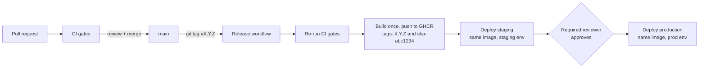

# Deployment and environment promotion

## The flow



1. **Pull request.** Every change, including game data, dashboards and alert
   rules, starts on a short-lived branch. CI runs lint, strict typing, data
   validation, the manifest check, tests with a coverage gate, pip-audit,
   gitleaks, actionlint, a Docker build, a Trivy scan and a Compose smoke test.
2. **Merge to main.** Branch protection requires a pull request and those checks
   (plus a code owner's review once there is a second maintainer). `main` is
   always releasable.
3. **Tag.** `git tag v1.0.0 && git push origin v1.0.0` starts
   `.github/workflows/release.yml`. The tag must match `app/__init__.py`.
4. **Publish.** The release workflow re-runs every CI gate on the tagged
   commit, then builds the image **once** and pushes it to GitHub Container
   Registry tagged with the version and the short git SHA. A GitHub Release is
   created with `data/manifest.json` attached, recording exactly which game
   data the image contains.
5. **Staging.** The `staging` job runs that image, by digest, with
   `compose.staging.yml` and smoke-tests it.
6. **Approval.** The `production` job uses the `production` GitHub
   environment, which has required reviewers. The run pauses until someone
   approves it in the Actions tab.
7. **Production.** The same digest runs with `compose.prod.yml` (prod env
   file, resource limits, log rotation) and is smoke-tested.

## Honest scope: what "deploy" means here

This project has a zero-cost constraint, so there is no cloud cluster.
"Deploying" in the release workflow starts the Compose stack on the GitHub
Actions runner, smoke-tests it and tears it down. It proves the promotion
mechanics (one immutable image, per-environment configuration, a human gate
before production) without pretending a server exists.

Locally, the same environments are one command each:

```bash
docker compose up -d --build                                            # dev
docker compose -f docker-compose.yml -f compose.staging.yml up -d       # staging
API_IMAGE=ghcr.io/farhanosmo/duo-game-api:1.0.0 \
  docker compose -f docker-compose.yml -f compose.prod.yml up -d --no-build   # prod-like
```

PowerShell for the prod-like line:

```powershell
$env:API_IMAGE = "ghcr.io/farhanosmo/duo-game-api:1.0.0"
docker compose -f docker-compose.yml -f compose.prod.yml up -d --no-build
```

`GET /api/v1/meta` reports the environment, git SHA and data version, which
is how you confirm what is running.

## Rollback

The service is stateless and every release is an immutable image, so
rollback is redeploying the previous version:

```bash
API_IMAGE=ghcr.io/farhanosmo/duo-game-api:<previous-version> \
  docker compose -f docker-compose.yml -f compose.prod.yml up -d --no-build
```

For a bad data change, revert the data commit and release a new patch version;
the history of every data version stays in git and on the Releases page.

## How the same pipeline would target a real cluster

The pipeline shape stays the same; only the deploy jobs change:

| Today (zero cost) | On a real platform |
|---|---|
| Compose on the CI runner | A managed Kubernetes cluster (EKS, GKE, AKS), provisioned with Terraform |
| `compose.staging.yml` / `compose.prod.yml` | Kustomize overlays or Helm values per environment |
| Deploy job runs `docker compose up` | Deploy job bumps the image digest in a GitOps repo; Argo CD or Flux syncs it |
| `/health` and `/ready` used by the smoke test | The same endpoints as liveness and readiness probes |
| Prometheus and Grafana in Compose | kube-prometheus-stack, or a hosted service such as Datadog or Grafana Cloud |
| Smoke test after deploy | Canary rollout (Argo Rollouts) gated on the same error-rate and latency SLIs |

## One-time GitHub setup

After creating the repository:

1. **Environments.** Settings > Environments > New environment > `staging`
   (no rules needed). Then Settings > Environments > New environment >
   `production` > tick **Required reviewers**, add yourself, and Save
   protection rules.
2. **Branch protection.** Settings > Branches (or Settings > Rules > Rulesets)
   > add a rule for `main`: require a pull request before merging (0 approvals
   while solo, since GitHub does not allow self-approval; 1 with code owner review
   once a second maintainer joins), require status checks to pass (`Lint, types, data and
   tests`, `Dependency audit and secret scan`, `Lint workflows (actionlint)`,
   `Build, scan and smoke test image`), and block force pushes.
3. **Package visibility.** After the first release, the image appears under
   the repository's Packages. Make it public if you want others to pull it
   without logging in.
